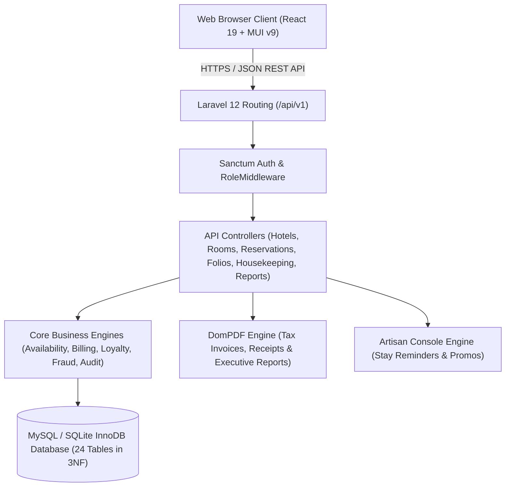
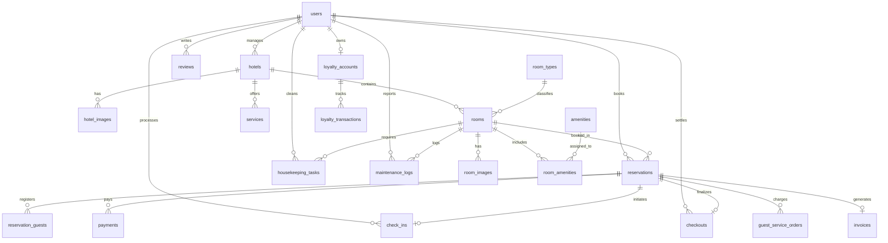
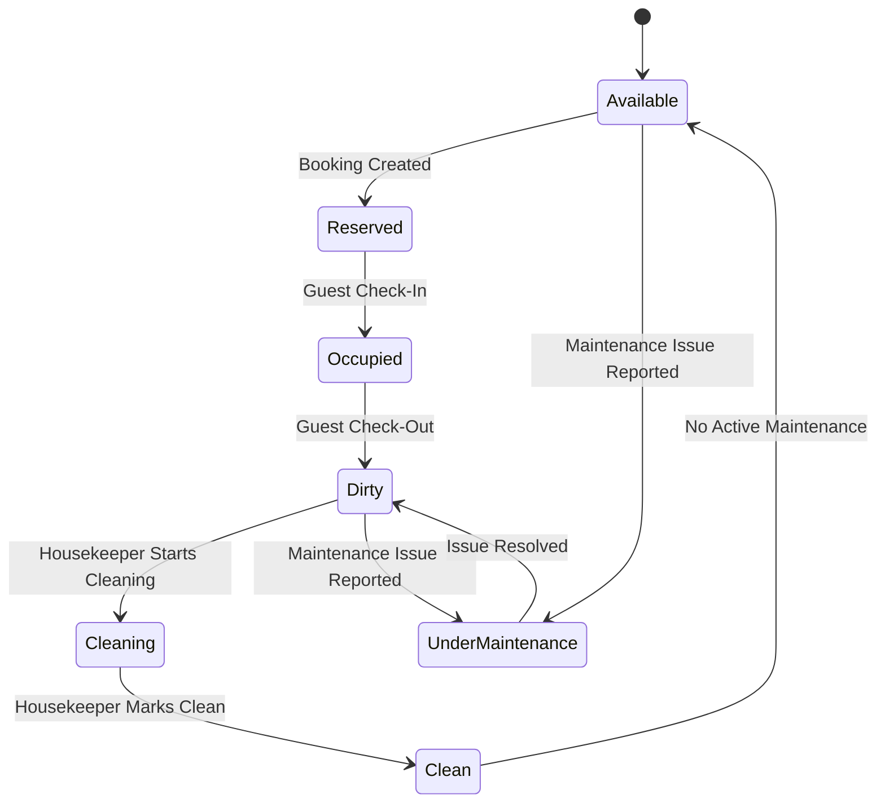

# RP Hotels & Resorts Group — Enterprise Reservation & Operations System
## Academic Project Report & Technical Specification
**Course:** ITLAW701 – Advanced Web Technologies  
**Institution:** Rwanda Polytechnic (RP) Karongi College | Level 7 Information Technology  
**Academic Year:** 2026  
**Repository:** Single-Root Laravel 12 + React 19 Monorepo  

---

## 1. Executive Summary

The **RP Hotels & Resorts Management System** is an enterprise-grade hospitality information system engineered to coordinate operations across three premier hotel branches in Rwanda:
1. **Kigali Grand Convention Hotel** (Kigali City)
2. **Karongi Lakeside Resort** (Western Province, Lake Kivu)
3. **Rubavu Waterfront Palms** (Western Province, Rubavu)

The solution solves key hospitality management challenges in the Rwandan tourism sector, including double-booking hazards during high-demand peaks, decentralized multi-branch room inventories, room turnover coordination between front desk and housekeeping, regulatory compliance with Rwandan tax laws (18% VAT), and automated fraud velocity monitoring.

The system is constructed as a modern, decoupled single-root monorepo utilizing **Laravel 12** on **PHP 8.4** for the transactional RESTful API backend and **React 19** paired with **Material UI (MUI v9)**, **Recharts**, and **i18next** for the responsive single-page application (SPA) frontend.

---

## 2. System Architecture & Tech Stack



### Core Technologies:
- **Backend Framework:** Laravel 12.x running on PHP 8.4
- **Database Engine:** MySQL 8.x / SQLite InnoDB with foreign key integrity and composite indices
- **API Security:** Laravel Sanctum Bearer Token Authentication with custom variadic `RoleMiddleware`
- **Frontend Engine:** React 19, React Router v7, Vite 8, and Rolldown bundling
- **UI Component System:** Material UI (MUI v9) with custom ThemeMode system (Dark/Light mode)
- **Data Visualization:** Recharts (AreaChart, ComposedChart, BarChart, PieChart Donut)
- **Reporting Engine:** Barryvdh DomPDF for official PDF documents and native PHP streams for CSV export
- **Quality Assurance:** Pest PHP (44/44 passing feature tests) and Laravel Pint code styling

---

## 3. Relational Database Architecture (24 Tables in 3NF)

The database schema is normalized to **Third Normal Form (3NF)** across **24 sequentially ordered migration tables**, eliminating transitive dependencies and ensuring referential integrity through foreign key constraints:



### Summary of the 24 Database Tables:
1. `users`: Master user repository with roles (`guest`, `receptionist`, `housekeeping`, `admin`) and statuses (`active`, `inactive`, `suspended`).
2. `hotels`: Multi-branch property records (Kigali, Karongi, Rubavu) with contact information.
3. `hotel_images`: Gallery assets for property profiles.
4. `room_types`: Capacity categorizations (Standard Single, Deluxe Double, Executive Suite, Presidential Villa).
5. `amenities`: Catalog of room amenities (Wi-Fi, AC, Lakeview Balcony, Mini Bar, etc.).
6. `rooms`: Physical room inventory with unique composite index `(hotel_id, room_number)` and live room status enum.
7. `room_images`: Gallery images for specific rooms.
8. `room_amenities`: Many-to-many pivot table joining `rooms` and `amenities`.
9. `services`: Hotel hospitality services (Airport transfers, dining, spa, laundry) with unit pricing.
10. `reservations`: Master reservation records with unique confirmation codes (`KGL-2026-XXXXXX`), date ranges, and composite availability index `(room_id, check_in, check_out, reservation_status)`.
11. `reservation_guests`: Companion guests registered to a booking with ID/passport details.
12. `payments`: Payment transactions with unique reference codes, methods (`cash`, `card`, `mobile_money`), and payment statuses.
13. `check_ins`: Guest arrival records logging receptionist ID, check-in timestamp, and special requests.
14. `checkouts`: Guest departure records logging room charges, additional service charges, discounts, and total settled amount.
15. `guest_service_orders`: In-house folio charges linked to reservations and services.
16. `invoices`: Official RRA-compliant tax invoices with unique invoice numbers (`INV-2026-XXXXXX`), subtotal, discount, 18% VAT, and total.
17. `housekeeping_tasks`: Cleaning turnover assignments with status lifecycle (`dirty`, `cleaning`, `clean`).
18. `maintenance_logs`: Facilities engineering repair tickets with priorities (`low`, `medium`, `high`, `urgent`) and statuses (`pending`, `in_progress`, `resolved`).
19. `reviews`: Post-stay guest satisfaction ratings (1–5 stars) with verified stay foreign key constraint.
20. `loyalty_accounts`: Guest points balances (`total_points`, `available_points`).
21. `loyalty_transactions`: Audit log of earned, redeemed, and refunded points.
22. `notifications`: In-app notification messages across 7 categories (`booking`, `payment`, `checkin`, `checkout`, `housekeeping`, `maintenance`, `promo`).
23. `audit_logs`: Immutable security audit log tracking user ID, action, target table, target ID, and IP address.
24. `fraud_flags`: Automated risk detection flags with risk levels (`low`, `medium`, `high`) and review statuses.

---

## 4. Role-Based Access Control (RBAC) & Security

The platform enforces strict role separation using Sanctum token authentication and middleware:

| Role | Access Scope & Allowed Workspace Sections |
| :--- | :--- |
| **`guest`** | Public search & discovery, booking engine, personal reservations folio, online payment simulation, invoice downloads, loyalty account, verified reviews, profile management. |
| **`receptionist`** | Front desk operations dashboard, confirmation code lookup, guest check-in & key assignment, in-house service order folio posting, balance settlement & checkout, live visual room availability board, maintenance reporting. |
| **`housekeeping`** | Housekeeping operations board, assigned cleaning turnover tasks, one-click cleaning status progression, room turnover verification, maintenance reporting for broken fixtures. |
| **`admin`** | Complete platform control: executive analytics dashboard, multi-branch hotel & room configuration, user & role administration, operations command center, financial reporting (PDF/CSV exports), fraud anomaly triage & account suspension, promotional broadcasts. |

### Security & Fraud Detection Engine:
The `FraudDetectionService` runs automated behavioral velocity checks:
- **IP Velocity:** Flags `high` risk when $\ge 3$ accounts register from the same IP within 1 hour.
- **Unpaid Booking Velocity:** Flags `medium` risk when a user creates $\ge 3$ unpaid reservations within 24 hours.
- **Overlapping Booking Spam:** Prevents race conditions and logs repeated collision attempts.
- **Account Suspension Guard:** Admins can review flagged accounts and immediately suspend credentials, revoking all active Sanctum tokens.

---

## 5. Concurrency Control & Anti-Double-Booking Engine

To completely eliminate double-booking risks under concurrent requests, `AvailabilityService` and `ReservationController` utilize a strict date-overlap formula combined with **Pessimistic Locking**:

### Exact Date-Overlap Condition:
Two reservations $[A_{in}, A_{out}]$ and $[B_{in}, B_{out}]$ collide if and only if:
$$\text{check\_in} < B_{out} \quad \text{AND} \quad \text{check\_out} > B_{in}$$

```php
$overlapping = Reservation::where('room_id', $roomId)
    ->whereIn('reservation_status', ['pending', 'confirmed', 'checked_in'])
    ->where(function ($query) use ($checkIn, $checkOut) {
        $query->where('check_in', '<', $checkOut)
              ->where('check_out', '>', $checkIn);
    })->exists();
```

### Concurrency Protection with Pessimistic Locking:
During booking creation, the transaction locks the selected room record using `lockForUpdate()`, re-evaluates the overlap condition inside the database transaction boundary, and rolls back atomically if a race condition is detected.

---

## 6. Financial Architecture, Billing & 18% VAT

All billing calculations follow the standard Rwandan taxation and hotel accounting framework implemented in `BillingService`:

$$\text{Room Charges} = \text{Price Per Night} \times \text{Nights}$$
$$\text{Additional Charges} = \sum (\text{Service Unit Price} \times \text{Quantity})$$
$$\text{Subtotal} = \text{Room Charges} + \text{Additional Charges}$$
$$\text{Discount} = \min(\text{Subtotal}, \text{Redeemed Points} \times 50 \text{ RWF})$$
$$\text{Taxable Base} = \text{Subtotal} - \text{Discount}$$
$$\text{VAT (18\%)} = \text{Taxable Base} \times 0.18$$
$$\text{Total Invoice Amount} = \text{Taxable Base} + \text{VAT}$$

- **Simulated Payment Gateways:** Integrates instant simulated gateways for **Credit/Debit Card**, **MTN Mobile Money / Airtel Money**, and **Front Desk Cash**.
- **Official Documents:** Automatically compiles and renders official PDF Tax Invoices and Receipts via DomPDF formatted with corporate branding.

---

## 7. Room Turnover & Maintenance State Machine



- When a guest checks out, the room immediately transitions to **`dirty`**, and a **`HousekeepingTask`** is automatically generated.
- When housekeeping completes cleaning, the system checks whether active maintenance logs exist. If none exist, the room status resets to **`available`**.
- If a maintenance issue is reported, the room transitions to **`under_maintenance`**, removing it from public booking availability.
- When maintenance is resolved, the room transitions to **`dirty`** and a post-maintenance inspection task is automatically assigned to housekeeping.

---

## 8. Executive Analytics, Reports & Scheduled Automation

1. **Executive Dashboard (`AdminDashboard.jsx`)**:
   - 6 KPI widgets (Revenue, Occupancy, Available Rooms, Active Bookings, In-House Guests, Satisfaction).
   - Recharts AreaChart for 7-day revenue velocity.
   - Recharts Donut PieChart for live inventory status.
   - Recharts BarChart comparing branch revenue and occupancy.
2. **Reports Center (`ReportsAnalyticsPage.jsx`)**:
   - Filterable by branch, custom date range, and daily/weekly/monthly aggregation.
   - 4 Recharts visual panels using `RECHARTS_COLORS`.
   - Comprehensive SQL aggregate financial breakdown by Room Type (`COUNT`, `SUM`, `AVG`, `MIN`, `MAX`).
   - Staff performance metrics tracking check-ins, check-outs, cleanings, and maintenance actions.
   - **One-click PDF Export** via DomPDF and **Streamed CSV Export** via PHP output streams.
3. **Scheduled Reminders Command (`php artisan hotel:send-reminders`)**:
   - Automatically identifies confirmed reservations arriving tomorrow and checked-in guests departing tomorrow, dispatching personalized notification reminders.

---

## 9. Evaluation Guide & Verification Credentials

### Pre-Seeded Evaluation Accounts:
All accounts share the password: **`Hotel@2026`**

| Role | Email Address | Access Level & Starting Route |
| :--- | :--- | :--- |
| **System Administrator** | `admin@rphotels.rw` | Full Executive Access (`/admin/dashboard`) |
| **Front Desk Receptionist** | `reception@rphotels.rw` | Front Desk Workspace (`/reception/dashboard`) |
| **Housekeeping Staff** | `housekeeping@rphotels.rw` | Housekeeping Turnover Board (`/housekeeping/dashboard`) |
| **Registered Guest** | `guest@rphotels.rw` | Guest Portal & Bookings (`/guest/dashboard`) |

### Verification Test Suite:
Run the full test suite using Pest PHP:
```bash
php artisan test
# Output: Tests: 44 passed (217 assertions)
```

To compile production frontend assets:
```bash
npm run build
```

---

## 10. Conclusion

The **RP Hotels & Resorts Management System** fulfills all requirements specified in **Section C of the ITLAW701 Advanced Web Technologies examination**. It demonstrates production-level proficiency across relational database modeling, transactional API design, concurrency safety, role-based authorization, automated state transitions, and responsive Material UI frontend development.
